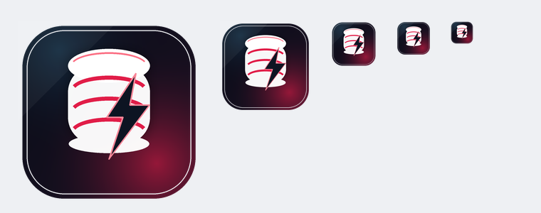
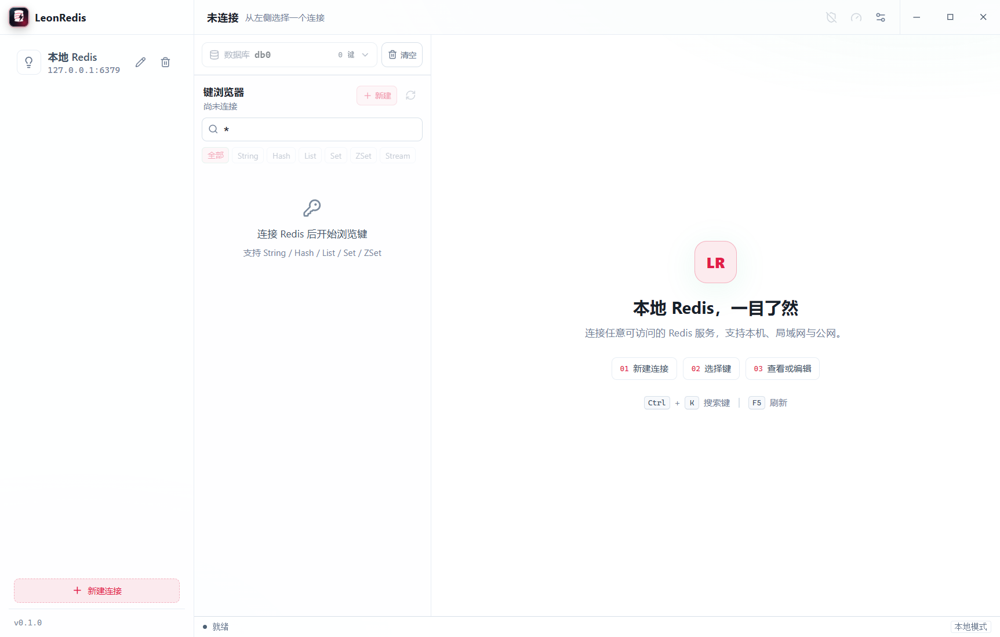
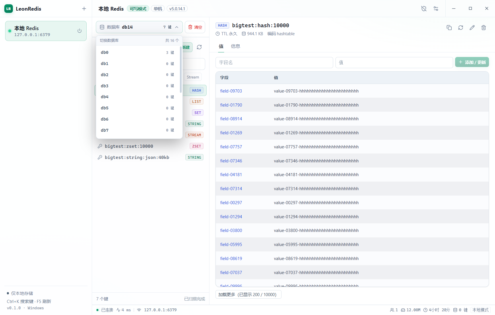
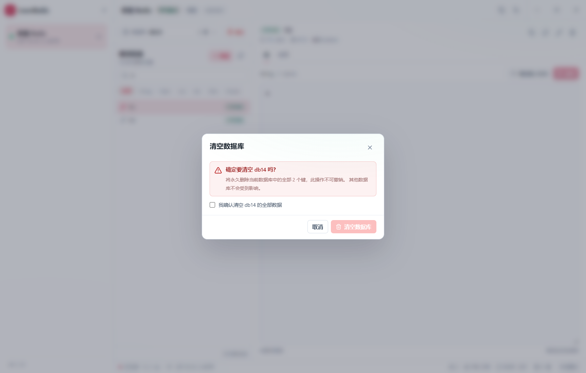
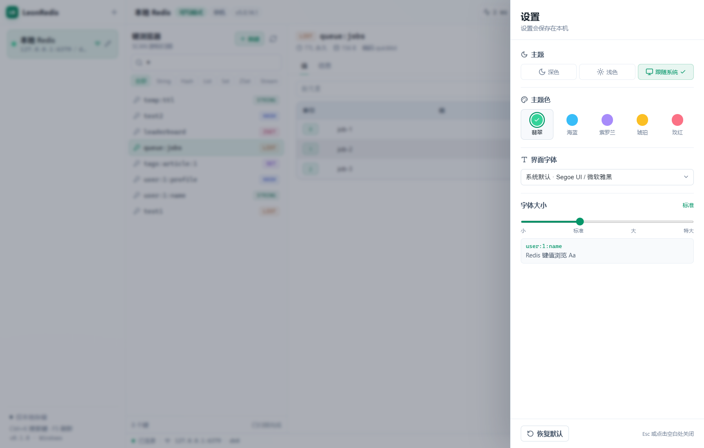
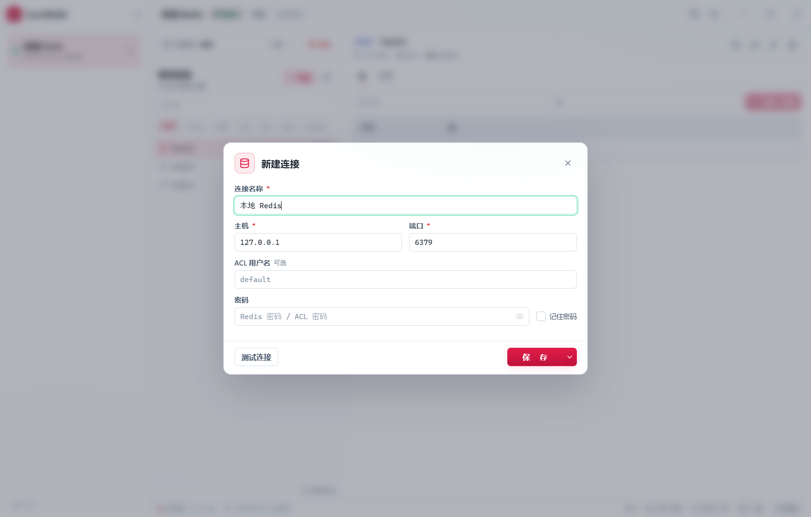
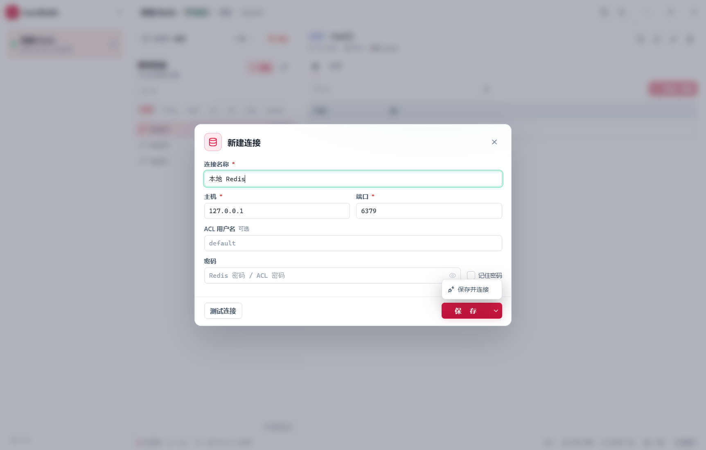
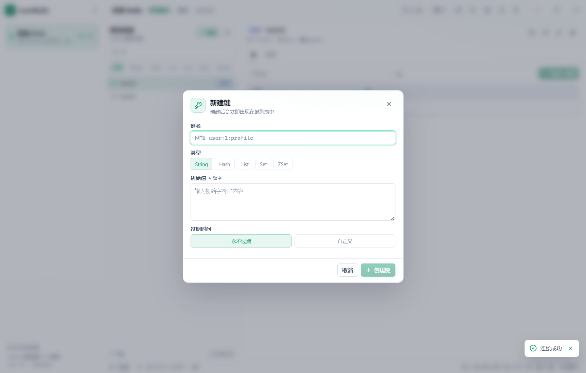
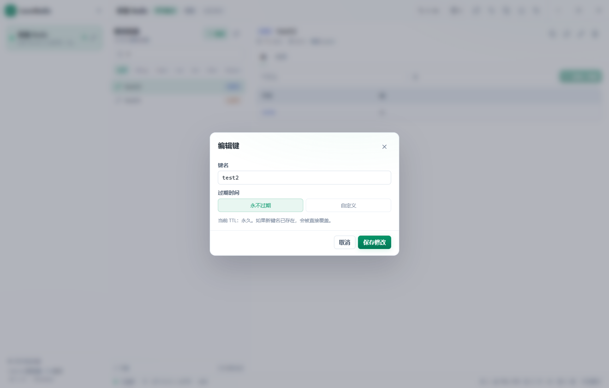
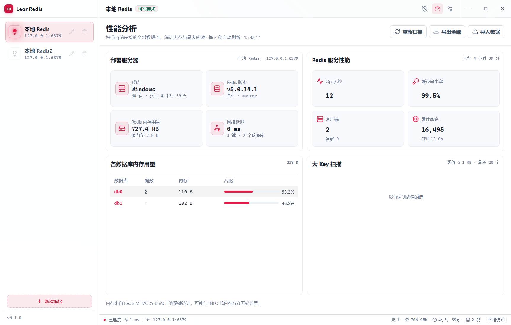

# LeonRedis

一个面向 Windows 的 Redis 可视化客户端，支持本机、局域网和公网可访问的 Redis 服务。技术栈为 **Tauri 2 + React + TypeScript + Rust**，默认中文界面，数据与连接配置只保存在本机。



- GitHub：<https://github.com/ly-0418/LeonRedisClient>
- Windows 安装包：[installers/LeonRedis_1.0.0_x64-setup.exe](installers/LeonRedis_1.0.0_x64-setup.exe)
- 安装包校验：[installers/SHA256.txt](installers/SHA256.txt)

当前版本为 v1.0.0，重点能力：

- 连接管理：保存/编辑/删除连接，通过连接卡片左侧的链接按钮建立连接，点击卡片本身不再连接；连接后可断开，断开前不可连接、编辑或删除。删除入口位于连接卡片右侧，需二次确认。支持记住密码（Windows DPAPI 加密）。
- 远程连接：支持本机、局域网、公网域名、IPv4 / IPv6 和自定义端口；主机输入框可直接粘贴 `host:port` 或 `redis://host:port`。
- 数据库选择：连接后按服务器 `databases` 配置生成 db0..dbN，并显示各库键数；支持带警告确认的清空当前库。
- 性能分析：全库内存统计、大 Key 扫描、服务器与服务性能、网络延迟，以及整连接 JSON 导入导出。
- 无边框窗口：去除原生标题栏，自定义 48px 顶栏融合连接信息与窗口控制；单机模式和版本号移入性能页。
- 键浏览：基于 `SCAN` 游标分页，支持 `MATCH` 模式与类型筛选，Redis 5 自动降级为客户端类型过滤；每个键的类型标签固定显示在最右侧。
- 新建/编辑键：键名、类型和过期时间在同一个弹框中设置，默认永不过期。
- 表格展示：Hash / List / Set / ZSet 使用更清晰的表头、隔行底色和主题色 hover，不再绘制行分割线；List 使用索引胶囊，表头和数据统一左对齐。
- 可调分栏：连接栏 / 键浏览器 / 值区域之间支持鼠标拖动调整宽度，双击恢复默认。
- 值查看与编辑：String、Hash、List、Set、ZSet 的基础可视化操作，全部通过按钮完成；List 使用单一「插入」按钮追加到末尾。String 文本域左侧显示行号，滚动同步。
- 新建键：支持 String、Hash、List、Set、ZSet，带类型对应的初始值表单。
- 过期时间：新建键和编辑键弹框统一设置，默认永不过期，支持常用时长快捷选项。
- 外观设置：深色 / 浅色 / 跟随系统，5 种主题色，9 种界面字体预设，字体大小可动态调整并持久化。
- 软件图标：深色玻璃底、数据库圆柱与闪电组合，已应用到 exe、安装包、任务栏和侧栏品牌图标。
- 安全护栏：只读模式（前端 + 后端写操作同时拦截）、危险操作确认、密码使用 Windows DPAPI 加密保存且不写明文。
- 中文界面、高 DPI 适配、Windows 安装包配置。

> 第一版不包含 Cluster、Sentinel、SSH 隧道、TLS、账号云同步。这些是后续迭代项。

















---

## 环境要求

- Windows 10/11 x64
- Node.js 20+
- pnpm 9+
- Rust stable（MSVC toolchain，1.88+）
- Visual Studio 2022 Build Tools，勾选「使用 C++ 的桌面开发」
- WebView2 Runtime（Windows 11 通常自带）

检查环境：

```powershell
node --version
pnpm --version
rustc --version
cargo --version
```

如果 Rust 依赖下载慢，项目内的 `.cargo/config.toml` 已配置 `rsproxy.cn` 镜像；不需要时可以删除该文件，恢复官方 crates.io。

## 启动

```powershell
pnpm install
pnpm tauri dev
```

如果当前终端还找不到 `cargo`，使用带 PATH 修正的脚本（安装完 Rust 后建议新开一个终端）：

```powershell
.\scripts\dev.ps1
```

只启动前端（没有 Redis 后端，会提示使用 `pnpm tauri dev`）：

```powershell
pnpm dev
```

## 构建

```powershell
pnpm build
pnpm tauri build
```

或：

```powershell
.\scripts\build.ps1
```

构建产物在 `src-tauri/target/release/bundle/`。当前配置只生成 NSIS 安装包，安装模式为「当前用户」，不需要管理员权限。

### 一键打包到 release/

每次修改完成后运行：

```powershell
.\scripts\package.ps1
```

脚本会依次执行 Rust 单元测试、TypeScript 检查、Tauri release 构建，然后把产物复制到项目根目录：

```text
release\LeonRedis.exe
release\LeonRedis_1.0.0_x64-setup.exe
```

打包前请关闭正在运行的 `LeonRedis.exe`，否则 Windows 会锁定文件；脚本会给出明确提示。

临时跳过测试：

```powershell
.\scripts\package.ps1 -SkipTests
```

> 当前构建未配置代码签名。分发给其他人时，Windows SmartScreen 可能提示未知发布者；正式发布前应配置 OV/EV 代码签名证书。

### Windows 安装升级行为

- 安装程序使用自定义 `src-tauri/nsis/installer.nsi`。
- 已存在任意版本时不再显示“卸载/重装”维护页面。
- 安装新版本前会静默执行旧版 `uninstall.exe /S`，然后直接安装当前版本。
- 安装目录中的 `data` 运行数据会保留：旧卸载器只删除已知程序文件，不递归删除整个目录。
- 安装期间若旧程序仍在运行，NSIS 会静默结束旧进程后继续升级。

### Linux / HarmonyOS 平台状态

当前发布包只包含 Windows x64。Linux 和 HarmonyOS 安装包不能在这台 Windows 构建机上直接交叉生成：

- Linux：需要 Linux 构建环境（WebKitGTK、GTK、AppIndicator、patchelf 等），并补齐 Linux 密码存储实现后运行 Tauri Linux 打包。
- HarmonyOS：Tauri 2 没有官方 HarmonyOS target；需要单独的 ArkTS/ArkWeb 外壳和 OHOS Redis 客户端，使用 DevEco Studio 与 HarmonyOS SDK 编译签名 `.hap`。

在具备对应 SDK 的构建机上才能生成可安装的 `.deb` / AppImage 和 `.hap`。

### 打包时 NSIS 下载超时

如果 `tauri build` 卡在 `Downloading nsis-3.13.zip`，可以手动准备 Tauri 的工具缓存：

1. 下载 `nsis-3.13.zip`（GitHub 或镜像）。
2. 解压到 `%LOCALAPPDATA%\tauri\NSIS`，确保 `makensis.exe` 直接位于该目录。
3. 下载 `nsis_tauri_utils.dll`，放到 `%LOCALAPPDATA%\tauri\NSIS\Plugins\x86-unicode\additional\`。

再次执行 `pnpm tauri build` 会复用本地缓存。

## 项目结构

```text
.
├─ src/                       React 前端
│  ├─ components/             连接、键浏览、值编辑、外观设置、窗口控制
│  ├─ hooks/useResizableLayout.ts  三栏宽度拖拽与持久化
│  ├─ lib/                    Tauri invoke 封装与类型
│  ├─ stores/appStore.ts      Redis 应用状态
│  ├─ stores/settingsStore.ts 主题与字体设置
│  ├─ App.tsx
│  └─ styles.css
├─ src-tauri/
│  ├─ src/
│  │  ├─ commands.rs          Tauri 命令：连接/SCAN/值读写/新建键
│  │  ├─ redis_manager.rs     redis-rs 连接、INFO、超时
│  │  ├─ state.rs             连接池与配置状态
│  │  ├─ storage.rs           本机配置与加密密码文件读写
│  │  ├─ models.rs            前后端数据模型
│  │  └─ lib.rs               Tauri 入口
│  ├─ capabilities/           Tauri 2 权限
│  └─ tauri.conf.json
├─ assets/icon.png            图标源文件
└─ pnpm-workspace.yaml        允许 esbuild 执行安装脚本
```

## 本机数据

所有应用配置、密码和 WebView 缓存统一放在可执行文件所在目录的 `data` 下：

```text
<安装目录>\data\
  connections.json
  secrets.json
  settings.json
  webview\EBWebView\
```

首次启动会自动把旧版 `%APPDATA%\com.leon.redisclient` 与
`%LOCALAPPDATA%\com.leon.redisclient` 中的数据迁移到安装目录，并清理旧目录。

密码默认不保存。勾选「记住密码」后，密码使用 Windows DPAPI 加密后写入 `secrets.json`。
文件中只有密文，明文不会落盘；取消勾选并保存会删除对应密文。

主题、字体和字号现在写入 `settings.json`，不再依赖 WebView 的 `localStorage`。
安装程序使用当前用户安装模式，安装目录必须可写；如果把 exe 放在只读目录，配置将无法保存。

## 常用测试命令

在 Redis 中准备一些测试数据：

```redis
SET user:1:name "张三"
SET user:1:email "zhangsan@example.com"
HSET user:1 profile city "上海" age "28"
RPUSH queue:jobs "job-1" "job-2" "job-3"
SADD tags:article:1 "redis" "tauri" "rust"
ZADD leaderboard 100 "alice" 85 "bob" 72 "carol"
EXPIRE user:1:name 3600
```

然后在客户端里：

1. 新建连接，主机 `127.0.0.1`，端口 `6379`。数据库不在新建弹框里选择。
2. 在键浏览器顶部的数据库下拉框选择 db0、db1 等，选项后会显示该库键数。
3. 在键浏览器输入 `user:*` 或 `*`。
4. 点击键查看值，尝试编辑 String / Hash / Set / ZSet。
5. 点击键面板右上角「新建」，创建 String、Hash、List、Set 或 ZSet。
6. 点击右上角齿轮，切换深色 / 浅色 / 跟随系统，并调整字体和字号。

## 当前实现细节

### 连接

- 每个连接配置对应一个 `MultiplexedConnection`，保存在 Rust 端 `AppState`。
- 点击左侧已有连接会直接连接，不再弹出连接确认框。
- 连接状态通过卡片最左侧的链接图标表示：未连接为灰色链接，已连接为绿色断开链接并高亮。
- 连接配置不再包含环境颜色属性。
- 每张卡片左侧是连接/断开按钮，右侧直接显示编辑和删除按钮；已连接时编辑和删除禁用。
- 点击连接卡片本身不再触发连接，必须使用「连接」按钮。
- 删除使用独立确认弹框；编辑弹框内不再提供删除。
- 密码框右侧提供常驻的小眼睛按钮，可在明文和掩码之间切换。
- 删除只移除本机连接配置和对应密码密文，不影响 Redis 数据；删除当前连接会先断开。
- 勾选「记住密码」后，密码通过 Windows DPAPI 加密保存，后端连接时自动解密使用。
- 编辑连接时会解密已保存密码并回填到密码框，可直接查看或修改。
- 连接弹框不再提供取消按钮；通过右上角关闭、点击遮罩或 `Esc` 退出。
- 测试连接位于底部最左侧；保存按钮默认执行保存，右侧下拉可选择「保存并连接」。
- 连接名称、主机、端口为必输项，带红色星号；校验失败时输入框红色高亮。
- 保存按钮宽度收窄，「保存」两个字之间与两端留白相等；下拉「保存并连接」与保存组等宽。
- 连接成功后，右下角客户端数、内存、运行时间、当前库键数每 5 秒自动刷新。
- 键浏览器底部不再显示键数量；仅在未扫描完成时显示「继续加载」，扫描完成后底部区域完全隐藏。
- 连接超时 6 秒，普通命令超时 5 秒。
- 命令通过 `redis-rs` 的异步 API 执行，前端只负责展示。

### 键扫描

- 使用 `SCAN cursor MATCH pattern COUNT n`，禁止 `KEYS`。
- Redis 6+ 使用服务端 `TYPE` 过滤；Redis 5 遇到 `syntax error` 会自动降级为客户端 `TYPE` 过滤。
- 每次默认返回 300 个键，前端「继续加载」推进游标。
- 刷新时保留旧列表和当前选中键，只叠加顶部进度条与淡出状态，不再清空界面。
- 每个键通过 pipeline 查询 `TYPE`，类型标签固定在最右侧。

### 分栏拖拽

- 连接栏与工作区之间、键浏览器与值区域之间各有一条透明拖拽热区。
- 鼠标悬停显示主题色分隔线，拖动实时调整宽度。
- 宽度保存在 `localStorage`，窗口缩放时自动限制到可用范围。
- 双击分隔线恢复默认宽度。

### 性能分析



- 连接成功后点击顶栏仪表盘按钮切换性能分析页，页面切换带淡入/上移动画。
- 性能页使用四宫格布局：
  - 左上：部署服务器，系统（Windows/Linux）、架构、Redis 版本、运行角色、内存用量、网络延迟
  - 右上：Redis 服务性能，Ops/s、缓存命中率、客户端/阻塞客户端、累计命令、CPU 时间
  - 左下：各数据库内存用量明细表，高度铺满剩余空间
  - 右下：大 Key 扫描明细表，高度铺满剩余空间
- 部署服务器与 Redis 服务性能区域设置更高的最小高度。
- 全部指标每 3 秒静默自动刷新，不闪烁、不重复显示加载遮罩。
- 大 Key 扫描默认只显示内存大于等于 **1 KB** 的键，可在设置页手动调整数值和 B/KB/MB/GB 单位。
- 指标数字更新时用平滑滚动过渡，数据库占比条使用宽度动画，不再瞬间跳变。
- 扫描当前连接配置的全部数据库，统计：
  - Redis 总内存
  - 各数据库键内存与占比
  - 总键数
  - 内存占用最大的 20 个 Key，包含数据库、键名、类型和内存
- 内存使用 `MEMORY USAGE` 逐键统计，与 `INFO` 总内存可能因 Redis 开销存在差异。
- 「导出全部」将全部数据库的键以 Redis `DUMP` 结果 + Base64 写入 JSON 文件。
- 「导入数据」通过 `RESTORE ... REPLACE` 恢复键值、类型和 TTL；只读模式下禁用。
- 导入会覆盖同库同名键，其他键保留，执行前会显示确认弹框。
- 弹框、性能页、连接/断开和数据表格均带过渡动画。

### 数据库切换

- 数据库选择位于键浏览器最顶部，与键浏览区域之间用分割线隔开。
- 使用自定义下拉菜单，不使用原生 `select`。
- 新建连接不再填写数据库编号，默认进入 db0。
- 连接后通过 `CONFIG GET databases` 读取服务器配置的最大数据库数量。
- 每个 db 选项显示该库当前键数，键数来自 `INFO keyspace`。
- 切换数据库通过 `SELECT` 完成，随后刷新键列表和服务器信息。
- 每次重新连接成功后默认进入 db0，之后可通过下拉切换。
- 当前数据库会写回连接配置，但下一次重新连接仍会重置为 db0。
- 下拉框右侧提供「清空」危险操作按钮，执行 `FLUSHDB`，只影响当前库。
- 清空属于危险操作：会显示键数、不可撤销警告，并要求勾选确认后才能执行。

### 值读取

- String 最多展示 64 KB，超过后禁用直接编辑，避免误覆盖。
- String 文本域行号与内容滚动同步；长行不自动换行，以保证行号与逻辑行一一对应。
- Hash/Set 使用 `HSCAN`/`SSCAN` 游标分页。
- List 使用 `LRANGE` 偏移分页，ZSet 使用 `ZRANGE WITHSCORES`。
- List 的「插入」按钮固定追加到末尾；仍保留删除和按索引编辑。
- List 行使用独立索引胶囊和斑马纹，Hash / Set / ZSet 同样使用斑马纹且不绘制行分割线。
- Stream 当前提示暂不支持可视化，后续版本补上。
- 刷新详情时保留旧内容，延迟 120ms 才显示轻量刷新提示；快速请求不会闪烁。
- 有 TTL 的键在详情顶部显示实时倒计时，每秒更新；到期后显示「已过期」。

### 无边框窗口

- Tauri 窗口启用 `decorations: false`，去掉 Windows 原生标题栏。
- 左侧连接栏从窗口顶部开始，不再有横跨全宽的标题栏；顶部显示 `LR` 图标和 `LeonRedis`。
- 右侧工作区顶部是 48px 一体栏：左侧显示连接名称和可写/只读状态，右侧保留性能分析、设置和最小化、最大化/还原、关闭。
- 单机模式和 Redis 版本号在性能分析页展示，不再占用顶栏。
- 可写/只读切换按钮位于顶栏性能分析按钮左侧；顶栏只显示当前模式标签。
- 连接信息卡片不再显示 db 编号；每张卡片左侧是链接/断开链接按钮，右侧直接显示编辑和删除按钮。
- 主机地址支持公网域名、IPv4、IPv6 和外部端口；输入 `host:port` 或 `redis://host:port` 会自动拆分主机和端口。
- 底部状态栏整行已移除；连接卡片中的网络延迟区域也已移除。
- 左侧连接栏：新建连接按钮位于左下角版本号上方的分割线之上，文字和图标居中，使用当前主题色。
- 连接和断开按钮固定在卡片最左侧、无边框：未连接显示灰色链接图标，连接成功后显示绿色断开链接图标并高亮发光。
- 链接、断开链接、编辑、删除按钮高度占满卡片内容区域，图标竖向居中。
- 链接图标悬停时显示背景色；断开链接图标无背景色，悬停时图标与周围光晕一起变暗。
- 已保存连接名称或 IP 超出卡片宽度时自动滚动展示，鼠标悬停暂停。
- 编辑/删除按钮不再折叠隐藏，直接展示；连接期间禁用。
- 连接、编辑、删除按钮统一为 32×32px。
- 顶栏空白区域可拖动窗口，双击可最大化/还原。
- 最小化、最大化/还原、关闭均已接到 Tauri 窗口 API。

### 外观设置

- 右侧抽屉式设置面板，打开和关闭都有滑入/滑出动画。
- 设置抽屉包含主题、主题色、字体、字号和大 Key 阈值。
- 所有弹框使用“抽纸”式加载/销毁动画，关闭后保留短暂残影再消失。
- 所有设置立即生效，不需要确认；没有右上角关闭按钮，通过点击空白处或 `Esc` 关闭。
- 深色、浅色、跟随系统三种模式；跟随系统会读取系统偏好，并监听系统主题变化。
- 5 种预置主题色：翡翠、海蓝、紫罗兰、琥珀、玫红。
- String 值文本域和输入框聚焦边框跟随当前主题色，而不是固定默认色。
- 字体预设：系统默认、微软雅黑、Segoe UI、等线、宋体、黑体、Consolas、Cascadia Code、等宽字体。
- 字号：小 / 标准 / 大 / 特大。当前「标准」以旧版「特大」为基准重新标定。
- 大 Key 阈值：可手动输入数值并选择 B / KB / MB / GB，默认 1 KB。
- 设置即时生效并写入安装目录下的 `data\settings.json`。

## 已知限制

- 不支持 Cluster / Sentinel / SSH / TLS。
- 不支持二进制 key 的精确操作；当前以 UTF-8 lossy 方式展示。
- 不支持 Stream 可视化、Lua 编辑器、批量删除、导入导出。
- 只读模式目前是单连接全局开关，尚未持久化到连接配置。
- 没有虚拟列表，键数量特别大时建议配合 `MATCH` 使用。
- 密码默认仅内存保存；勾选「记住密码」后使用 Windows DPAPI 加密保存。

## 下一步建议

1. 为键列表增加虚拟滚动（TanStack Virtual），支持十万级 key。
2. 把连接拆成 actor：Pub/Sub、MONITOR、阻塞命令使用独立连接。
3. 已完成 Windows DPAPI 记住密码，后续可增加凭据管理入口与密码强度提示。
4. 增加 TLS、SSH 隧道、Cluster、Sentinel。
5. 增加二进制 key/value 的 Hex/Base64 视图。
6. 增加大 Key 扫描、慢查询、内存分析。
7. 增加 Playwright UI 测试与 Rust 集成测试（Docker Redis 多版本矩阵）。
